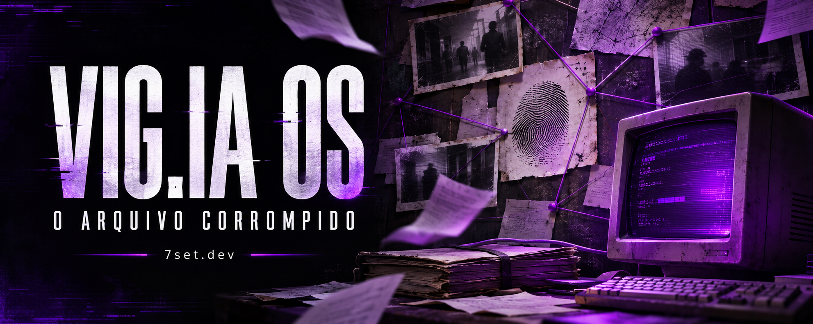
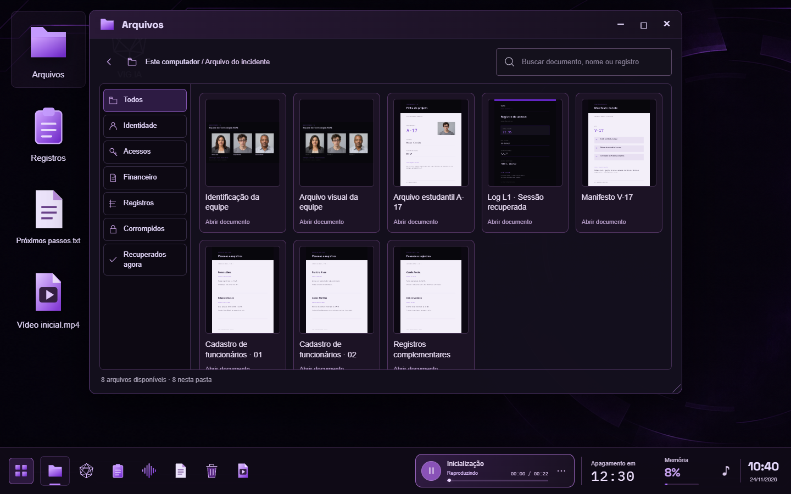
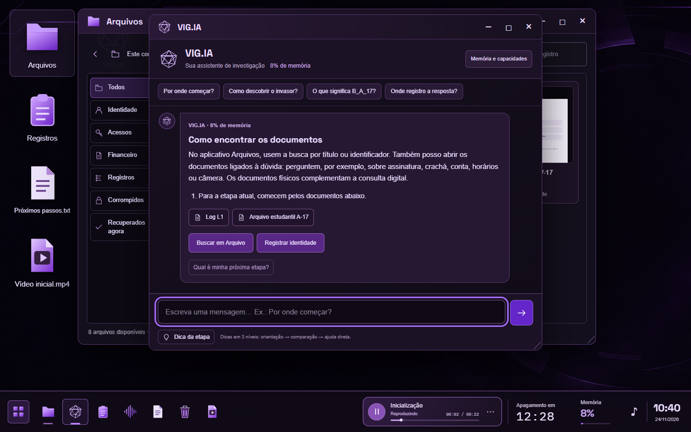
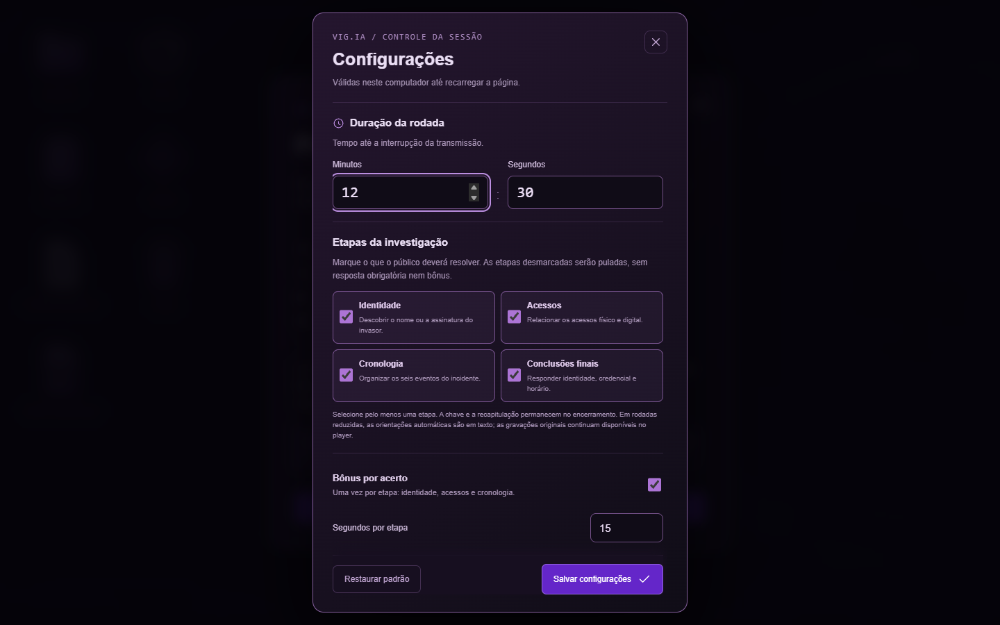
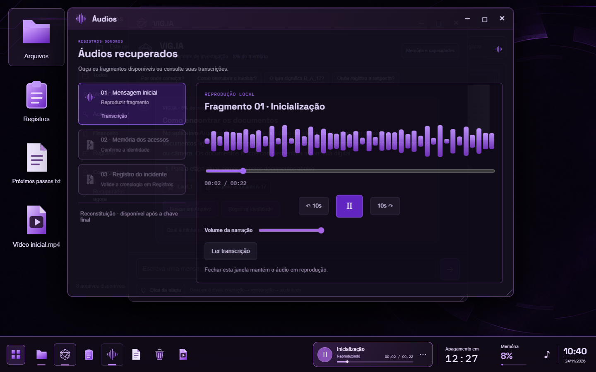
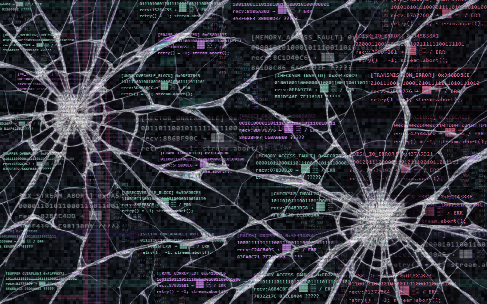
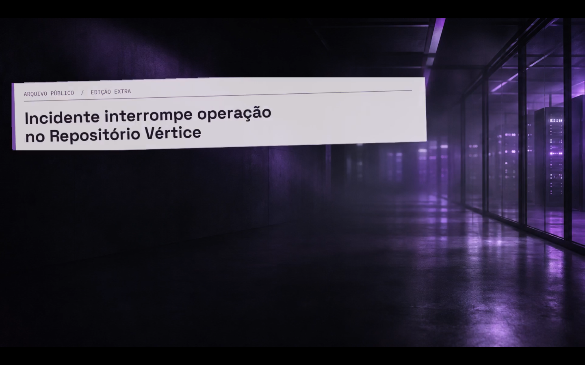
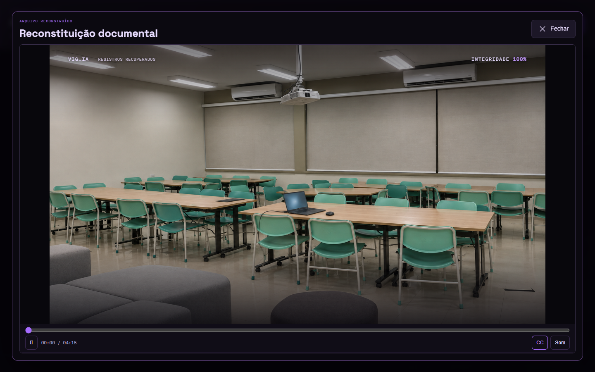

<p align="center"></p>
<p align="center"><strong>Um sistema operacional fictício que transforma um computador em uma cena de investigação.</strong></p>
<p align="center"><code>Design de experiência</code> · <code>Interfaces</code> · <code>Narrativa interativa</code> · <code>HTML / CSS / JavaScript</code></p>
<p align="center"><a href="#a-experiência">Projeto</a> · <a href="#por-dentro-do-sistema">Telas</a> · <a href="#vídeos">Vídeos</a> · <a href="#executar-localmente">Executar</a> · <a href="#publicação-na-vercel">Publicação</a></p>

## A experiência

**O Arquivo Corrompido** é um escape room escolar que conecta uma investigação presencial ao **VIG.IA OS**, um ambiente de computador criado para o jogo. Jornais, um painel de funcionários, pastas e um crachá escondidos na sala se relacionam com documentos, áudios e registros digitais.

Os participantes precisam interpretar evidências, relacionar pessoas e reconstruir um incidente antes de o relógio terminar. A interface faz parte da narrativa: a memória se recupera, novos arquivos aparecem e a assistente passa a oferecer orientações mais completas conforme a investigação avança.

Este repositório público apresenta a experiência, a implementação e o processo de produção como **portfólio**. O acervo inclui soluções e bastidores, identificados como spoilers.

| Frente | O que foi desenvolvido |
| --- | --- |
| Experiência | Investigação híbrida, progressão por etapas e condução de grupos. |
| Interface | Área de trabalho, explorador, chat, janelas, barra de tarefas e cursores próprios. |
| Narrativa | Caso fictício, documentos cruzados, áudios, pistas e reconstituição. |
| Audiovisual | Tutorial narrado, trilha ambiente, redução de volume durante voz e efeitos de falha. |
| Produção física | Painel, crachá, jornais, documentos complementares e cartaz de divulgação. |
| Implementação | Aplicação estática, regras locais, configurações de sessão e publicação na Vercel. |

## Por dentro do sistema

### Uma área de trabalho para investigar


Atalhos arrastáveis em grade invisível, menu iniciar, menu de contexto e janelas com minimizar, maximizar e restaurar. A barra de tarefas reúne os aplicativos, o tempo restante, a memória e o áudio.

### Arquivos que conectam as pistas



Os documentos aparecem em blocos com prévia, busca e categorias. Cada arquivo abre em uma janela de leitura; o catálogo cresce conforme as etapas são resolvidas.

### VIG.IA: assistência dentro da narrativa



Um chat com histórico, sugestões de pergunta, indicador de digitação e respostas ligadas à fase da investigação. A assistente aponta documentos e explica o que comparar. Ela funciona com regras e conteúdo local, sem serviço externo de IA.

<table><tr><td width="50%"><br><strong>Uma rodada para cada público</strong><br>Tempo, bônus e seleção de etapas configuráveis.</td><td width="50%"><br><strong>Som integrado à experiência</strong><br>Trilha contínua e redução automática durante voz e vídeo.</td></tr></table>

### O tempo também conta a história



Quando o tempo termina, o OS dá lugar a uma composição de erros de transmissão, códigos, trincas e ruído contínuo. É um efeito ficcional: nenhum arquivo real do computador é apagado.

As telas de desktop, explorador, chat, configurações e áudios foram capturadas novamente para esta apresentação. O acervo também preserva registros de versões anteriores.

## Vídeos

Clique nas prévias para abrir os arquivos de vídeo no repositório. Os MP4 também podem ser baixados para reprodução local.

### Apresentação e tutorial · aproximadamente 1min40s

[](public/video/Video_inicial.mp4)

[▶ Assistir ou baixar o tutorial em MP4](public/video/Video_inicial.mp4)

O vídeo apresenta o desafio e ensina a investigar no OS sem antecipar as soluções. Na partida, ele termina antes de o cronômetro começar. A voz de narração aprovada é Francisca Neural.

### Navegação pelo OS · gravação de produção

[](docs/videos/Navegacao_OS.mp4)

[▶ Assistir ou baixar a gravação de navegação](docs/videos/Navegacao_OS.mp4)

Gravação de tela utilizada na produção do tutorial, com interações e navegação reais. É um registro de produção, sem narração, e pode conter estados de demonstração.

<details><summary><strong>Encerramento e materiais da equipe — contém spoilers</strong></summary>



Após concluir as etapas, o grupo anota uma chave exibida por 30 segundos, insere o código e libera automaticamente uma reconstituição narrada de aproximadamente 4min15s. Essa reconstituição é um player feito em HTML, com imagens e narração sincronizadas, e não um segundo MP4 do tutorial.

O [guia da equipe](acervo/equipe/GUIA_DA_EQUIPE.md) documenta a solução. As fontes do encerramento ficam em [public/encerramento/filme](public/encerramento/filme/index.html), e a [narração completa](public/audio/final_completo.wav) também acompanha o projeto. Para assistir ao player, execute o projeto localmente.

</details>

## Como a investigação funciona

Preparação da equipe → tutorial → área de trabalho → identidade → acessos → cronologia → conclusões → anotação da chave → inserção → reconstituição.

| Recurso | Comportamento |
| --- | --- |
| Relógio | Padrão de 12min30s; começa somente ao terminar o primeiro vídeo. |
| Bônus | +15s por acerto nas três primeiras etapas, uma vez por etapa; configurável. |
| Memória | Na rodada completa: 8% → 34% → 67% → 67% → 100%. |
| Documentos | Catálogo progressivo de 8 até 25 evidências. |
| Respostas | Enter envia; acertos são aceitos mesmo sem abrir previamente os documentos. |
| Dificuldade | A equipe pode selecionar quais etapas serão exigidas. |
| Sessão | Configurações e posições dos atalhos voltam ao padrão ao recarregar. |

## Executar localmente

Com **Node.js 24**, abra um terminal na raiz:

```bash
npm ci
npm start
```

Acesse **http://127.0.0.1:4173**. Não são necessárias variáveis de ambiente, banco de dados ou chaves de API. Também é possível abrir `public/index.html` no Chrome ou Edge, mantendo a pasta completa; o servidor local é recomendado para conferir a publicação.

```bash
npm test          # Regras, etapas, tempo, HTTP e links
npm run check     # Referências e capitalização dos arquivos
npm run build     # Gera dist/ a partir exclusivamente de public/
npm run preview   # Serve a versão construída
```

## Publicação na Vercel

Importe este repositório do GitHub e mantenha:

| Configuração | Valor |
| --- | --- |
| Framework | Other |
| Root Directory | Raiz do repositório |
| Build Command | `npm run build` |
| Output Directory | `dist` |
| Node.js | 24.x |
| Variáveis de ambiente | Nenhuma |

O [vercel.json](vercel.json) já define a construção e a saída. Somente o sistema de `public/` chega ao site; o acervo, os impressos e os materiais de portfólio ficam acessíveis no GitHub. O [guia de publicação](docs/PUBLICACAO.md) detalha o envio pelo GitHub Desktop.

## Estrutura e bastidores

```text
public/       Sistema jogável, documentos, sons e vídeo inicial
materiais/    PDFs de impressão, jornais e cartaz em PNG/PDF
docs/         Documentação, capturas e vídeos de portfólio
acervo/       Fontes, editáveis, planejamento, histórico e guia com spoilers
scripts/      Servidor local, verificação e construção
tests/        Testes de regras e entrega
```

O antigo nome `privado/` foi substituído por **`acervo/`**: são materiais públicos de produção e operação do jogo, sem restrição de acesso pretendida. Caches, temporários, `dist/` e credenciais reais `.env*` permanecem fora do Git.

| Material | Arquivo |
| --- | --- |
| Cenário · 9 folhas A4 horizontais | [PDF de montagem](materiais/impressao/01_cenario/Cenario_A4_horizontal.pdf) |
| Documentos · 6 folhas A4 verticais | [PDF complementar](materiais/impressao/02_documentos/Documentos_A4_vertical.pdf) |
| Jornais · 3 folhas A3, fundo branco | [PDF dos jornais](materiais/impressao/03_jornais/Jornais_A3_3_folhas.pdf) |
| Divulgação · 03/12, das 7h às 15h | [Imagem PNG](materiais/divulgacao/Cartaz_03-12.png) · [PDF A4](materiais/divulgacao/Cartaz_03-12_A4.pdf) |

## Documentação e créditos

[Guia do jogo](docs/JOGO.md) · [Arquitetura](docs/ARQUITETURA.md) · [Contexto](docs/CONTEXTO.md) · [Nuvem e portfólio](docs/NUVEM.md) · [Testes](docs/TESTES.md) · [Acervo](acervo/README.md) · [Histórico](CHANGELOG.md).

Trilha: **Long Note One**, Kevin MacLeod, CC BY 4.0. Efeitos de falha: Pixabay. Fontes: Space Grotesk e IBM Plex Mono. Consulte os [créditos e licenças](LICENCAS.md) antes de reutilizar os materiais. Um repositório público não concede, por si só, uma licença geral de reutilização.

O sistema é totalmente cliente: soluções e controles podem ser inspecionados no código. As credenciais da interface são mecanismos de condução do jogo, não autenticação de servidor. Cada aba executa sua própria rodada; não há sincronização de equipes nem persistência do progresso após recarregar.

<p align="center"><sub>7set.dev · O Arquivo Corrompido · Projeto escolar e portfólio de experiência interativa · 2026</sub></p>
