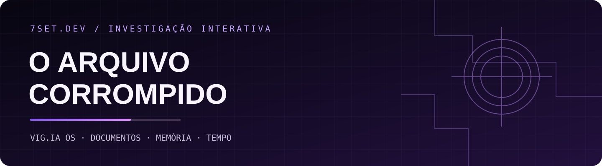
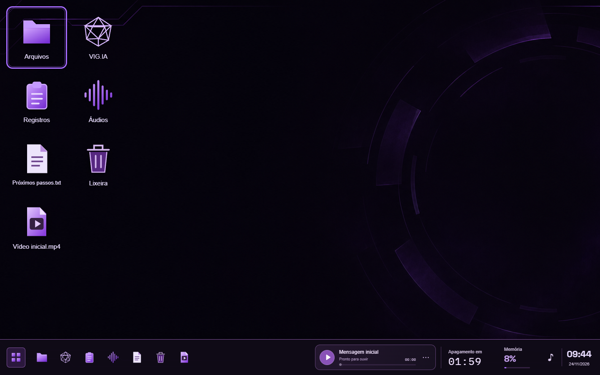

<p align="center"></p>
<p align="center"><strong>Investigue os registros. Recupere a memória. Resolva o caso antes que o tempo termine.</strong></p>
<p align="center"><code>VIG.IA OS</code> · <code>HTML / CSS / JavaScript</code> · <code>Node 24</code> · <code>Vercel</code></p>
<p align="center"><a href="#começar">Começar</a> · <a href="#o-jogo">O jogo</a> · <a href="#publicar-no-github-e-na-vercel">Publicação</a> · <a href="#materiais-físicos">Impressão</a> · <a href="#documentação">Documentação</a></p>

## O jogo

**O Arquivo Corrompido** é um escape room escolar que combina investigação na sala com um computador fictício. Notícias, documentos, um painel de funcionários, pastas e um crachá se conectam às evidências do **VIG.IA OS**. A proposta é interpretar registros, cruzar fontes e reconstruir um incidente.

O computador oferece um explorador de arquivos, um chat com a VIG.IA, registros de respostas, áudios, anotações e o vídeo inicial. As janelas podem ser abertas, minimizadas e restauradas pela barra de tarefas. Os atalhos podem ser reorganizados em posições sem sobreposição durante a sessão.

| Recurso | Comportamento atual |
| --- | --- |
| Preparação | Configurações da equipe antes de entregar o computador ao grupo. |
| Tutorial | Vídeo narrado de aproximadamente **1min40s**, em tela cheia, iniciado por um clique dos participantes. |
| Relógio | Começa **somente ao terminar a primeira reprodução do vídeo**. Padrão: **12min30s**. |
| Etapas | Identidade → acessos → cronologia → conclusões. A equipe pode escolher quais serão exigidas. |
| Bônus | **+15s**, uma vez em cada uma das três primeiras etapas; configurável ou desativável. |
| VIG.IA | Assistente local com dicas e links para documentos; capacidade cresce com a memória recuperada. |
| Respostas | Acertos são válidos mesmo sem abrir previamente os documentos. Enter envia os formulários. |
| Conclusão | Código exibido por **30s** para anotação no papel → inserção do código → reconstituição narrada. |
| Tempo esgotado | Efeito de corrupção, tela trincada, ruído contínuo e cursor invisível. |

> A VIG.IA usa regras e conteúdo local. Não há chamada a um modelo externo, conta de IA, banco de dados ou chave de API para jogar.

<p align="center"><br><sub>Área de trabalho do sistema. A duração de cada rodada é configurável.</sub></p>

## Começar

**Com Node.js 24 instalado**, abra um terminal nesta pasta:

```bash
npm ci
npm start
```

Acesse **http://127.0.0.1:4173**. O projeto não possui dependências de execução. Para encerrar o servidor, use `Ctrl+C`.

Também é possível abrir **public/index.html** diretamente no Chrome ou Edge, mantendo toda a pasta `public` junto. O servidor local é o caminho recomendado para conferir o mesmo carregamento de arquivos usado na publicação. O jogo não precisa de Node quando já está hospedado.

**Para uma sessão:** prepare a sala, abra as configurações pela engrenagem, ajuste a rodada e entregue a tela de boas-vindas ao grupo. O clique em **Iniciar** libera vídeo e áudio. Ao fim do vídeo, a área de trabalho aparece e o relógio começa. As credenciais e o gabarito estão no [guia da equipe](privado/equipe/GUIA_DA_EQUIPE.md), incluído no repositório privado junto dos editáveis e do histórico.

## Publicar no GitHub e na Vercel

**Esta estrutura está preparada para GitHub → Vercel.** A construção copia somente `public/` para `dist/`. Os impressos, documentos e arquivos da equipe não são servidos no site.

1. Use um repositório **Private (privado)** no GitHub. O projeto inclui soluções e materiais da equipe; a privacidade depende dessa configuração do repositório.
2. Envie **o conteúdo desta pasta raiz**, incluindo `public`, `scripts`, `package.json` e `vercel.json`. O guia [Publicação](docs/PUBLICACAO.md) contém os comandos Git.
3. Na Vercel, escolha **Add New → Project**, conecte o GitHub e importe o repositório.
4. Mantenha a configuração abaixo e publique.

| Campo na Vercel | Valor |
| --- | --- |
| Root Directory | Raiz do repositório (`.`); não selecionar `public` |
| Framework Preset | **Other** |
| Build Command | `npm run build` |
| Output Directory | `dist` |
| Install Command | Automático (`npm ci` com o lockfile) |
| Node.js | **24.x**, definido em `package.json` |
| Variáveis de ambiente | Nenhuma |

O `vercel.json` já declara a construção e a pasta de saída. Não há reescrita de todas as rotas para `index.html`: imagens, vídeo, áudios e a reconstituição são arquivos reais. O endereço definitivo depende da criação do repositório e do primeiro deploy na sua conta.

Consulte as fontes oficiais: [configuração de construção](https://vercel.com/docs/builds/configure-a-build), [integração com GitHub](https://vercel.com/docs/git/vercel-for-github) e [limites de arquivos no GitHub](https://docs.github.com/en/repositories/working-with-files/managing-large-files/about-large-files-on-github). O maior arquivo desta entrega fica abaixo do limite de 100 MiB por arquivo; o envio por Git não exige Git LFS. Use Git ou GitHub Desktop, pois o upload pelo navegador tem um limite menor.

## Organização da entrega

```text
o-arquivo-corrompido/
├── public/                 Sistema completo que será publicado
│   ├── index.html          Entrada do jogo
│   ├── assets/             Fontes, identidade, ícones e cursores
│   ├── evidencias/         Documentos do explorador
│   ├── audio/              Fragmentos, narração, trilha e efeitos
│   ├── video/              Vídeo inicial em MP4
│   └── encerramento/       Reconstituição e seus recursos
├── materiais/
│   ├── impressao/          Cenário A4, documentos A4 e jornais A3
│   └── divulgacao/         Cartaz PNG e PDF A4 com data e horário
├── docs/                   Documentação vigente, sem gabarito
├── scripts/                Verificação, construção e servidor local
├── tests/                  Testes de regras, configuração e entrega
├── privado/                Equipe, gabarito, editáveis e histórico — no Git privado
├── .github/workflows/      Verificação automática no GitHub
├── package.json            Comandos e versão do Node
└── vercel.json             Configuração da hospedagem
```

**Código, impressos, divulgação e `privado/` são versionados no GitHub privado.** Isso inclui os editáveis, as referências, os ZIPs de identidade e o histórico. O nome `privado/` apenas organiza o conteúdo: o controle de acesso é a visibilidade **Private** do repositório.

`dist/`, `.reports/`, `node_modules/`, `.vercel/`, credenciais reais `.env*`, caches e arquivos temporários ficam fora do Git. São saídas regeneráveis ou dados de ambiente, não as fontes do projeto. A Vercel publica exclusivamente `dist/`, gerada de `public/`; `.vercelignore` também lista as áreas da equipe para exclusão nos fluxos que a utilizam.

## Materiais físicos

| Arquivo | Impressão / uso |
| --- | --- |
| [Cenário](materiais/impressao/01_cenario/Cenario_A4_horizontal.pdf) | **9 folhas A4 horizontais**, tamanho real; painel, fichas, crachá e peças de montagem. |
| [Documentos complementares](materiais/impressao/02_documentos/Documentos_A4_vertical.pdf) | **6 folhas A4 verticais**, tamanho real; pistas selecionadas e documentos de distração. |
| [Jornais](materiais/impressao/03_jornais/Jornais_A3_3_folhas.pdf) | **3 folhas A3 verticais**, fundo branco, uma cópia de cada. Inclui a folha de recortes/manchetes. |
| [Cartaz em PNG](materiais/divulgacao/Cartaz_03-12.png) | Arquivo principal para divulgação: **03/12, das 7h às 15h**. |
| [Cartaz em PDF A4](materiais/divulgacao/Cartaz_03-12_A4.pdf) | Versão diagramada para impressão do cartaz. |

As instruções de papel e montagem estão em [materiais/impressao/README.md](materiais/impressao/README.md). A distribuição das pistas entre as pastas e os objetos escondidos está no guia local da equipe. Os impressos complementam o sistema; não precisam conter sozinhos todas as respostas.

## Verificação e manutenção

```bash
npm test          # Regras, progressão, bônus, combinações de etapas e entrega HTTP
npm run check     # Referências, maiúsculas/minúsculas, mídia e configuração
npm run build     # Verifica e gera dist/ exclusivamente a partir de public/
npm run preview   # Abre o mesmo conteúdo construído em http://127.0.0.1:4173
```

O fluxo do GitHub executa instalação, testes e construção em Linux. Para o teste visual opcional, veja [Testes](docs/TESTES.md). Relatórios da conferência desta entrega ficam na pasta local `.reports/`; eles não são publicados nem enviados ao GitHub.

## Limites que a equipe deve conhecer

- O jogo funciona no navegador, com gabarito e controles no código do cliente. As senhas da interface **não são autenticação de servidor**. Mesmo em repositório privado, participantes podem inspecionar o JavaScript recebido.
- Cada aba tem sua rodada. Não há sincronização de equipes, placar online ou recuperação de progresso depois de recarregar a página. Recarregar restaura as configurações padrão.
- A versão hospedada precisa de internet para obter os arquivos; não existe cache offline garantido. Para a escola, mantenha uma cópia completa de `public/` no computador.
- O primeiro clique do participante é necessário para áudio e vídeo pelas regras dos navegadores. Teste Chrome ou Edge no computador, na resolução e nas caixas de som reais da sala.
- O aviso de apagamento é parte da ficção: o sistema não apaga arquivos do computador.

## Documentação

| Documento | Conteúdo |
| --- | --- |
| [Guia do jogo](docs/JOGO.md) | Fluxo do participante, aplicações, progressão e tempo. |
| [Publicação](docs/PUBLICACAO.md) | GitHub, Vercel, atualização e solução de problemas. |
| [Backup na nuvem](docs/NUVEM.md) | O que fica no GitHub privado e o que chega ao site. |
| [Arquitetura](docs/ARQUITETURA.md) | Estrutura do código, mídia e fronteira de publicação. |
| [Contexto e continuidade](docs/CONTEXTO.md) | Decisões vigentes, histórico resumido e próximos trabalhos. |
| [Testes](docs/TESTES.md) | Comandos, cobertura e o que conferir na sala. |
| [Créditos e licenças](LICENCAS.md) | Música, efeitos, fontes e identidade. |
| [Histórico da entrega](CHANGELOG.md) | Alterações desta organização final. |

A pasta [privado/](privado/README.md) contém guia da equipe, narrativa integral, editáveis e documentação histórica. Ela acompanha o clone do **repositório privado**, mas não aparece no site da Vercel. Após commit e push, esses materiais ficam guardados na nuvem com o restante do projeto. Mudanças ainda sem commit/push continuam apenas na cópia local.

<p align="center"><sub>7set.dev · Entrega consolidada em 24/11/2026 · Projeto escolar “O Arquivo Corrompido”</sub></p>
