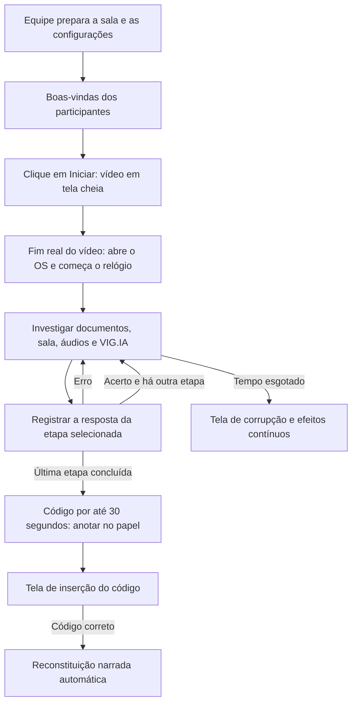

# Guia do jogo · VIG.IA OS

Documento vigente em 24/11/2026. Não contém o gabarito. O guia integral da equipe está em `acervo/equipe/GUIA_DA_EQUIPE.md`, no repositório público e fora do site dos participantes.

## Proposta

Investigar um incidente fictício no Repositório Vértice por meio de documentos, notícias, um painel de funcionários, pastas e um crachá escondidos na sala. O grupo relaciona o material físico aos registros de um computador parcialmente recuperado. Público e dificuldade podem variar; a equipe escolhe as etapas exigidas antes de iniciar.

## Fluxo da sessão

O vídeo inicial dura aproximadamente 100 segundos. Ele não avança a contagem da investigação. A primeira reprodução exige conclusão: a tentativa de avançar o vídeo é revertida, e Esc não libera o desktop. Se houver erro ao carregar a mídia, a tela oferece nova tentativa e retorno à preparação, mantendo o relógio parado.

Depois da primeira exibição, o mesmo MP4 permanece como atalho e app na área de trabalho. Reabri-lo não pausa nem reinicia a rodada; fechar o app interrompe a reprodução. Se a rodada expirar durante o replay, o vídeo é interrompido para apresentar a falha.

## Aplicativos

| Aplicativo | Uso |
| --- | --- |
| Arquivos | Explorar evidências por categoria e busca; blocos com prévia abrem documentos em janela. |
| VIG.IA | Conversar em um chat, receber explicações e abrir documentos indicados nas respostas. |
| Registros | Responder as etapas; a cronologia é uma etapa interna deste app. |
| Áudios | Reproduzir os fragmentos disponíveis e consultar as transcrições. |
| Anotações | Consultar o arquivo de orientação que se atualiza conforme a etapa. |
| Vídeo inicial | Rever o tutorial após o primeiro término. |
| Lixeira | Compor a metáfora de área de trabalho; não contém uma etapa obrigatória do enigma. |

O botão de início reúne aplicativos e ações do OS. O menu de contexto da área de trabalho e a barra de tarefas também dão acesso à navegação. A barra mantém ícones dos apps, estado da memória, relógio e controles de áudio. Janelas conservam o estado ao minimizar e restaurar. Posições dos atalhos usam uma grade invisível e duram somente a sessão da página.

## Progressão padrão

| Situação | Memória | Evidências disponíveis | Próxima ação |
| --- | --- | --- | --- |
| Início | 8% | 8 | Relacionar uma assinatura ao perfil investigado. |
| Identidade confirmada | 34% | 23 | Distinguir quem forneceu cada tipo de acesso. |
| Acessos confirmados | 67% | 24 | Ordenar seis eventos. |
| Cronologia confirmada | 67% | 25 | Correlacionar identidade, credencial e minuto crítico. |
| Conclusões corretas | 100% | 25 | Anotar a chave, inseri-la e assistir à reconstituição. |

Os acertos não exigem leitura registrada de documentos. Uma resposta correta é aceita mesmo que o grupo chegue a ela pelos impressos. Erros trazem pistas e caminhos dentro do sistema. A cronologia oferece arrasto com indicação das posições e orientação de uso.

Se etapas forem desmarcadas pela equipe, elas são puladas automaticamente e o percentual passa a considerar as etapas exigidas. Não existe rodada com zero etapas. O código e a reconstituição continuam sendo o fechamento depois da última etapa selecionada.

## Assistência progressiva

A VIG.IA é uma personagem e um mecanismo local de orientação. Não acessa a internet nem conhece perguntas fora de sua base. Reconhece variações de escrita, aponta evidências e explica comparações de acordo com a fase. O chat exibe memória e nível de capacidade, sugestões de pergunta e indicador de digitação. As respostas não devem revelar antecipadamente a chave final.

## Tempo e som

A duração padrão é 12min30s. O bônus padrão soma 15s uma única vez por acerto nas etapas identidade, acessos e cronologia: máximo de 45s em uma rodada completa. O aviso de acréscimo desaparece sozinho. Conclusões finais não geram bônus. A equipe pode alterar duração, ativar/desativar o bônus e ajustar seu valor antes de iniciar.

Aos 60, 30 e 15 segundos, surgem alertas visuais com sirenes. Nos últimos 10 segundos, o painel mostra a contagem e o relógio marca cada segundo. Os avisos visuais ficam ativos mesmo com os alertas sonoros desligados. A opção de alertas não desliga os efeitos da falha final. A música ambiente é a mesma ao longo da investigação e abaixa quando há voz ou vídeo; o usuário também dispõe dos controles de áudio.

Ao terminar o tempo, a corrupção ocupa a tela com fragmentação visual, binários, trincas, efeitos contínuos e cursor invisível. Esc não retorna ao OS. O aviso faz parte da ficção e não altera arquivos do computador. A sessão permanece encerrada ao atualizar a aba. A equipe pode reiniciar para uma nova rodada pelo painel reservado.

## Código e encerramento

Concluídas as etapas, o relógio de investigação para. Um pop-up mostra a chave com contagem própria de 30 segundos e som de relógio. O grupo deve anotá-la no papel. É possível confirmar a anotação antes do fim; ao fechar, o código deixa de ficar disponível para consulta e abre o terminal de inserção. O formato de exemplo é `XXXX-XXXX-XXXX`.

Ao fim da recapitulação, a tela de parabéns orienta o grupo a sair da sala ou rever o vídeo. A rodada permanece encerrada mesmo ao atualizar a aba.

A inserção correta abre automaticamente uma reconstituição de aproximadamente 4min15s, com narração, imagens e legendas. A chave não deve aparecer no tutorial, nos cartazes ou na documentação destinada aos participantes.

Para reservar a sala, considere cerca de **19min40s** de mídia e rodada no cenário padrão completo: 1min40s de tutorial + 12min30s de investigação + até 45s de bônus + até 30s de cópia + 4min15s de reconstituição. Preparação, digitação do código e conversa posterior acrescentam tempo. O grupo pode concluir antes.
